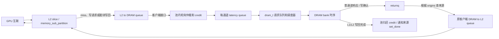

# Memory pool 解耦改造说明

本次依据师兄在 `noteFromZhangShuyi_1019.md` 中提出的任务：把 DRAM controller 从 `memory_partition_unit` 拆到新的 memory pool，先让原有单 GPU 计算与访存流程正常运行，并验证拆分前后的行为一致。

原项目：`D:\SJTU\Studying\26-27-1\Z\FlashGPU_Sim_Baseline-main`。
改造副本：`D:\SJTU\Studying\26-27-1\Z\FlashGPU_Sim_MemoryPool-main`。
完成日期：2026-10-27。逐项测试数据见 [验证结果](validation/VALIDATION_RESULTS.md) 和 [机器可读结果](validation/results.json)。

## 1. 设计目的和完成范围

原代码把 GPU 侧 L2 子分区和 HBM 通道控制器放在同一个 `memory_partition_unit` 中；`dram_t` 又保存 partition/GPU 指针，向该 partition 通知写回完成，并从 GPU 读取时钟。控制器的归属、请求来源和一个 GPU 的 partition 编号因而联系在一起。

改造后，`memory_partition_unit` 保留 L2 和队列，`memory_pool` 负责 DRAM 通道、请求仲裁和延迟队列；控制器通过通道上下文读取时间、上报写回完成。池中的一个通道可以注册多个独立客户端。池接纳请求时记录来源，完成时据此选择回程目标。

本阶段保持单 GPU 默认映射 `partition i -> channel i`，便于严格比较拆分前后的行为。控制器所有权和请求回程已经拆开；后续多 GPU 系统还需把池接入系统级驱动，并处理地址路由、统一供时、互联和统计。

## 2. 所有权如何变化

拆分前：

```text
gpgpu_sim
  └─ memory_partition_unit[i]
       ├─ memory_sub_partition[]：L2、L2->DRAM 队列、DRAM->L2 队列
       ├─ arbitration_metadata：轮询位置、private/shared credit
       ├─ m_dram_latency_queue
       └─ dram_t：调度器、bank 时序、请求队列、returnq
            ├─ 回指 memory_partition_unit
            └─ 回指 gpgpu_sim
```

拆分后：

```text
gpgpu_sim（目前的单 GPU 初始化/推进入口）
  ├─ memory_partition_unit[i]：memory_pool_client 的适配器
  │    └─ memory_sub_partition[]：L2 和两侧队列
  └─ memory_pool
       └─ channel_state[i]：dram_context 的实现
            ├─ 多个 client/local_id 端点
            ├─ 每通道仲裁、credit、latency_queue
            ├─ origins：mem_fetch* -> 来源端点
            └─ unique_ptr<dram_t>
```

partition 借用池的引用，不再拥有 `dram_t`。池拥有通道对象，通道拥有 `dram_t`。客户端、配置和统计对象由外部提供，在被使用期间必须有效。注册须在 `seal()` 前完成；客户端注销时不能还有由池接管的在途请求。回调只把普通响应放入客户端队列，写回请求仍由控制器删除。

这里的 `dram_t` 是已有的控制器与 DRAM 时序模型。功能数据读写仍沿用模拟器原有机制。

## 3. 对照原图理解每条路径



**L2 命中。** 请求在原 `memory_sub_partition::cache_cycle()` 中完成 L2 查找、排队和回包，没有进入池。原图中的 set、tag/data、MSHR、L2 命中处理仍由 L2 代码负责。

**L2 miss / 普通读。** L2 把 `mem_fetch*` 放入原 `L2_dram_queue`。池查看各端点队头；返回队列有空间、credit 足够且 DRAM 对应读/写调度资源允许时，才接纳请求。此时从 L2 队列弹出请求，保存来源并借用 credit，设置 `ready_cycle = 当前累计周期 + dram_latency`。到期后提交 `dram_t`，经过原调度器和 bank 时序进入 returnq。池按来源把响应送回客户端的 `dram_L2_queue`，归还 credit 并删除来源记录。后续 L2 fill、MSHR 唤醒及互联响应沿用原路径。

**普通写。** 进入池之前，仍由原 L2 写策略决定是否、何时下发。送入 DRAM 的普通写经过原来的调度；启用独立写队列时，由控制器内部写队列及水位策略处理。完成后以 `WRITE_ACK` 经 returnq 返回来源客户端。L2 命中的 write-back store 可能仅把 cache line 标脏，暂时没有 DRAM 访问，因此仅检查程序算对不足以验证写回路径。

**L1/L2 写回。** 对 `L1_WRBK_ACC`、`L2_WRBK_ACC`，DRAM 完成时调用 `dram_context::complete_writeback()`。池找到来源、归还 credit、调用客户端的 `writeback_done()`，适配器再调用对应子分区的 `set_done()` 清理请求跟踪。控制器随后删除写回请求。这类请求没有普通读响应或写确认回包。

**返回阻塞。** 来源客户端的 `dram_L2_queue` 满时，池保留 returnq 队头，暂不归还 credit，也不删除来源记录；有空间后再送达。接纳新请求时也保留了原有的返回队列空间检查。组件测试刻意先堵塞、后恢复，检查请求不会丢失、重复送达或送错客户端。

**简化 DRAM 模式。** `simple_dram_model` 使用池内固定延迟队列，跳过详细 bank 时序。到期的普通请求经同一个来源路由送回客户端；写回请求调用同一个完成接口后删除。执行顺序仍为先处理到期响应，再仲裁新请求。

图中 L2->DRAM 队列内读/写的两种颜色表示请求类型；控制器中的 Default Q / Write Q 才涉及调度器读写队列的配置。不能把每条颜色路径都理解成单独的新硬件对象。

## 4. 执行顺序和时钟

详细模式中，每个通道在一个 DRAM 时钟事件内按以下顺序执行：

1. 尝试把已有 returnq 队头送回 L2。
2. 执行 `dram_t::cycle()` 并采样日志。
3. 从客户端端点轮询接纳至多一个新请求，放入延迟队列。
4. 若延迟队列队头到期且控制器有空间，将其提交给 `dram_t`。

这与原 `memory_partition_unit::dram_cycle()` 顺序一致。调换顺序可能让请求提前或推迟一个事件，造成计算结果正确但周期统计改变。仲裁还保留原队头策略：选中的候选因对应 DRAM 队列满而不能下发时，本次停止选择。

驱动在 `clock_mask & DRAM` 事件中调用一次 `memory_pool::cycle(gpu_sim_cycle, gpu_tot_sim_cycle)`，池按原通道顺序推进所有通道。随后仍按原路径采集各通道功耗统计。

`dram_context::current_cycle()` 返回本 kernel 周期与先前累计周期之和；`kernel_cycle()` 返回当前 kernel 周期。状态时间戳和 FR-FCFS 统计分别采用与原来一致的口径。未来共享池须由系统驱动统一供时，避免多个 GPU 重复推进同一个池。

## 5. 来源记录与 credit

来源映射使用 `mem_fetch* -> (client*, local_id)`。`local_id` 是客户端内部子分区编号；不同 GPU 都可能有自己的子分区 0，仅凭该数值无法判断响应所属 GPU。接纳时记录客户端身份解决了池内回程问题。

现有单 GPU 适配器仍检查请求中的子分区编号与自己的 L2 子分区匹配。多 GPU 的地址到通道映射仍需另行接入。

credit 保留原算法：每个端点至少有一个 private credit，其余使用共享额度。共享额度由调度队列、返回队列和注册端点数量推导；特殊的零长度队列配置沿用原无限额语义。响应交给客户端或写回完成后归还 credit。注册较多客户端时，配置仍须能够容纳各端点的保底额度。

池在每个通道周期检查：

```text
accepted = responses + writebacks + pending
```

这些计数从池创建开始累计。`pending` 是池已接纳、尚未完成回程或写回清理的请求，不包含仍留在 L2 队列中的请求。`blocked_responses` 记录阻塞尝试次数，一个请求可能贡献多次。

## 6. 修改文件清单

| 文件 | 修改内容与目的 |
|---|---|
| 新增 `src/gpgpu-sim/memory_pool_interface.h` | 定义 L2 客户端接口与 DRAM 通道上下文，隔离具体 partition/GPU 指针。 |
| 新增 `src/gpgpu-sim/memory_pool.h` | 定义池的创建、注册、推进、统计与 DRAM 查询接口。 |
| 新增 `src/gpgpu-sim/memory_pool.cc` | 实现通道所有权、仲裁、credit、延迟队列、来源记录、响应路由和写回完成。 |
| `src/gpgpu-sim/l2cache.h` | partition 实现客户端接口，移出控制器、延迟队列与仲裁状态。 |
| `src/gpgpu-sim/l2cache.cc` | 创建 L2 后注册客户端；通过接口操作原队列；DRAM 统计委托给池。 |
| `src/gpgpu-sim/dram.h` | 控制器借用 `dram_context`；请求时间通过参数传入。 |
| `src/gpgpu-sim/dram.cc` | 替换直接读取 GPU 时钟和 partition 写回回调；沿用原 bank 命令及其时序算法。 |
| `src/gpgpu-sim/dram_sched.cc` | 从通道上下文读取时间，保留原调度逻辑。 |
| `src/gpgpu-sim/gpu-sim.h` | 增加池的所有者成员。 |
| `src/gpgpu-sim/gpu-sim.cc` | 创建池、注册默认通道映射、在 DRAM 事件推进池并输出统计。 |
| 新增 `validation/validate.py` | 在隔离副本中构建、运行并严格比较两版，生成报告。 |
| 新增 `validation/memory_pool_path_probe.cu` | 可逐元素验证的 CUDA 访存程序，覆盖读 miss 和小 L2 脏块驱逐。 |
| 新增 `validation/memory_pool_component_test.cc` | 两客户端共享一通道，检查来源路由、普通写确认、L1/L2 写回与阻塞恢复。 |
| 新增 `validation/` 日志、报告和清单 | 保存原始证据、比较结果及原目录 SHA-256 快照。 |
| 本文 `MEMORY_POOL_REFACTOR.md` | 说明需求、设计、路径、文件改动、验证方法和后续边界。 |

正式 `configs/` 参数未因验证改变。小缓存、窄返回队列和独立写队列参数只写入隔离运行目录，两版使用相同条件。

## 7. 如何判断是否达到改造目的

验收同时检查结构和行为。结构上，partition 不再拥有 `dram_t`、仲裁状态和 DRAM 延迟队列；`dram_t` 不再保存 partition/GPU 指针；池允许多个来源注册到同一通道。行为上，原示例计算正确，并严格比较逐 kernel 周期数、指令数、L2 总统计及逐通道 DRAM 命令计数。组件测试进一步检查共享通道的来源路由、完成通知和阻塞恢复。

README 的程序需要继续运行，但 `PTX_SIM_MODE_FUNC=1` 纯功能模式不足以验证这次改动。这里使用 `PTX_SIM_MODE_FUNC=0` 详细模式，关注模拟周期与事件计数；宿主机运行秒数不作为严格相等的依据。

比较完整 kernel 统计块，按 `kernel_launch_uid` 对齐。重复打印同一个 launch 时，只有所有参与比较的指标一致才合并，冲突则失败。逐通道比较 `n_cmd/n_nop/n_act/n_pre/n_req/n_rd/n_write/n_wr_bk`，不使用旧实现中未初始化的 `n_ref`。

**基线构建修复：** 原始 `l2cache.cc` 构造函数含 `: : m_id(partition_id)` 语法错误。验证脚本仅在 Linux 隔离基线副本中改为 `: m_id(partition_id)`。原目录没有这个修正；改造版构造函数已随拆分重写。因此本文的基线比较是相对这份仅修复语法的隔离基线进行的。

**测试调整记录：** 早期压力配置把 4 个 L2 set 与 IPOLY 索引搭配，触发原实现的支持数量断言，最终改为 4 set 的线性索引。最早短探针也曾因大 L2 命中而没有 DRAM 流量，最终加入未预填 L2 的输入读，并要求池接纳数大于零、压力场景 L2 写回数大于零后才允许通过。这些调整应用于两版相同的验证条件。

最终逐项结果见 [验证报告](validation/VALIDATION_RESULTS.md)。`results.json` 保存周期、请求计数、池守恒统计和差异列表；原始 `.log` 文件可进一步复核。

### 本次验证结果

原版与改造版均完整编译通过。下表为逐 kernel 周期数，两版完全一致；详细统计差异列表也均为空。

| 场景 | 逐 kernel 周期数 | 验证重点 |
|---|---|---|
| 原有 vectorAdd | 30,133 | 计算正确；500,000 次 DRAM 请求一致。 |
| 原有 Triton GEMM | 78,989 | 计算正确；419,840 次 DRAM 请求一致。 |
| H100 配置探针 | 15,247；11,595 | 默认配置下实际产生读 miss。 |
| RTX5090 配置探针 | 15,156；11,454 | 第二套 GPU 配置下行为一致。 |
| H100 小 L2/窄队列 | 21,595；28,312 | 累计完成 1,975 次 L2 写回。 |
| H100 独立写队列 | 21,543；30,289 | 累计完成 1,928 次 L2 写回。 |
| H100 简化 DRAM | 15,044；11,595 | 固定延迟路径及正确回程。 |

共享通道组件测试另外通过 FR-FCFS、独立写队列、FIFO、简化 DRAM 四种模式。每种模式由两个客户端提交 8 个请求，得到 4 个普通响应与 4 个写回完成通知，最终 `pending=0`，并验证了阻塞解除后正常完成。

**内核结束与写回排空的边界：** 小 L2/窄队列场景结束时 `pending=1`，独立写队列场景结束时 `pending=24`。原版的 `gpgpu_sim::active()` 依赖 L2 请求跟踪等条件，不要求内部 L2 写回全部排空；本次沿用该退出条件，周期数、逐通道计数以及可见延迟队列状态与基线一致。新增池统计使这些尾部请求可见，且守恒检查通过。这些回归结果不能解释为“程序结束时所有内部队列均为空”；需要彻底排空的共享池生命周期应在后续系统集成时另外定义。

## 8. 本机复现方法

在 Ubuntu-22.04 / WSL 中运行。当前环境为 GCC 11.4、CUDA 12.8，`/usr/local/cuda` 指向该 Toolkit。

```bash
cd /mnt/d/SJTU/Studying/26-27-1/Z/FlashGPU_Sim_MemoryPool-main
python3 -B validation/validate.py --cuda /usr/local/cuda --jobs 4 --threads 8
```

脚本把原版与改造版分别复制到 Linux 用户缓存目录，在那里编译和运行，日志写入改造副本的 `validation/`。通过时返回码为 0，`results.json` 中 `passed` 为 `true`。输出不正确、缺少详细统计、守恒失败或前后比较不一致均不能通过。

复用本次隔离构建以节省编译时间：

```bash
python3 -B validation/validate.py \
  --work-root /home/zacharylinux/.cache/flashgpu-memorypool-l9sAcV \
  --skip-build --threads 8
```

仅在源码与已有构建一致时使用 `--skip-build`。`--reuse-tutorials` 会复核现有完整示例日志并运行探针与组件测试，用于此次恢复验证；重新完整验收可省略它以重跑示例。

## 9. 后续多 GPU 工作入口与当前边界

1. 把池创建和推进接到系统级驱动，让多个 GPU 向同一个池注册客户端。
2. 定义 GPU/地址到物理通道的映射，让请求中的 channel/bank/row 与池路由一致。
3. 整理跨 GPU 的配置与统计归属；当前 `memory_stats_manager_t` 仍来自单 GPU 初始化。
4. 接入跨 GPU 互联的延迟、带宽、公平性及需要的缓存一致性策略。

两客户端组件测试证明的是共享接口、回程和完成通知能够工作，没有运行两个完整 GPU，也没有验证多 GPU 缓存一致性。SST、gem5、功耗模型端到端场景未单独验收。本次也未为旧 `dram_t` 内部原始指针补做完整析构与内存泄漏验证。

## 10. 原目录和复制边界

副本排除了根目录 `.md/`、`ed0c02f8a4fe7ee43d88fb7f6c8e1d4e.png` 和 `noteFromZhangShuyi_1019.md`。需求说明只从原目录读取。

`validation/original_sha256.json` 是开始改造前的原文件哈希；最终完整性检查和差异清单见 `validation/source_manifest.json`，源码差异见 `validation/source_changes.patch`。原目录哈希与副本差异可以独立复核。

